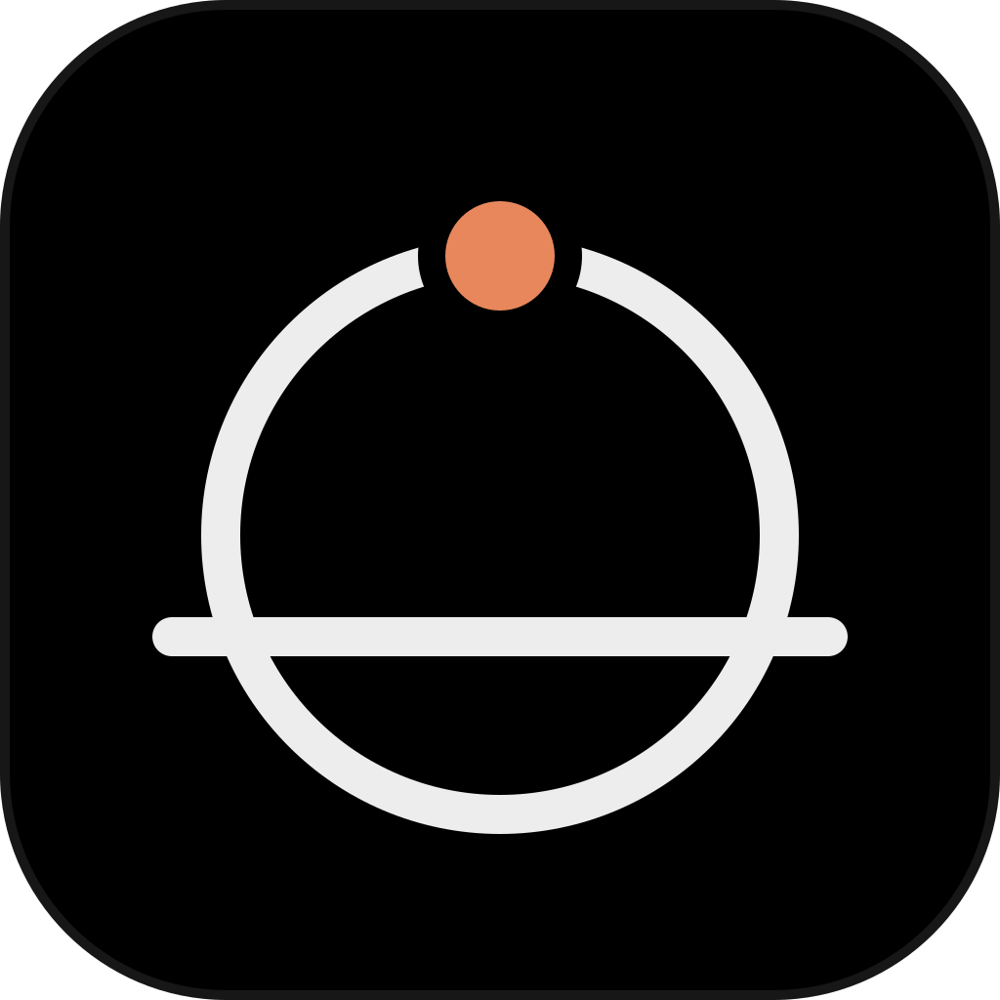
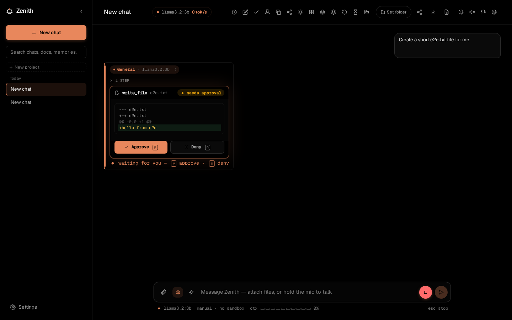

# Zenith

A self-hosted AI workspace that runs on your own hardware with your own
[Ollama](https://ollama.com) models. It covers chat, a coding agent that asks
before it acts, document Q&A, deep research, long-term memory, voice and
image generation. Nothing leaves your machine unless you turn on a feature
that needs the web.

Run it with Docker, install it as a desktop app (Tauri), or open it from your
phone over your LAN or Tailscale.



## Quick start

You need [Ollama](https://ollama.com) running locally.

**Docker**

```bash
docker compose up -d --build                   # http://localhost:5173
docker compose --profile search up -d --build  # optional: adds a SearXNG search container
```

**Manual** (Python 3.11–3.13, Node 18+)

```bash
./install.sh          # sets up the backend and frontend, then suggests models for your hardware
cd backend && ./run.sh
cd frontend && npm run dev
```

`install.sh` runs `python -m app.setup_models`. It detects your RAM, GPU and
VRAM, proposes chat, code and embedding models that will run well, and pulls
them when you confirm. You can re-run it any time from `backend/`.

## What it does

| | |
|---|---|
| **Chat** | Routes each message to the right installed model (code, reasoning, quick, vision) and shows why it picked it. Branching, edit-and-resend, per-message model override. |
| **Agent mode** | Multi-step tool use: shell, file edits with diff preview and undo, git, test runs, browser automation, sub-agents, MCP tools. Manual, semi-auto, full or plan-first autonomy. Optional Docker sandbox. |
| **Documents and memory** | Hybrid vector and keyword retrieval over uploads, watched folders and past conversations, with citations. Long-term memory with conflict review. |
| **Deep Research** | Multi-step search, read and report with inline citations. It can't touch your files or shell. |
| **Voice and images** | Whisper speech-to-text, Piper text-to-speech, wake word, and local Stable Diffusion if you point it at one. |
| **Personal tools** | Notes, to-dos, calendar, email (IMAP/SMTP), schedules, automations and webhooks, daily digest. |
| **Interface** | OLED Ember theme by default (true black, one warm accent) plus eight others. Thinking models stream their reasoning live, `y`/`n` approve agent steps, Esc stops, and a status line shows model, context and speed. |
| **Observability** | Per-turn traces: routing decision, retrieved context, every tool call, time to first token. Health panel and usage dashboard. |

The full reference is in [docs/FEATURES.md](docs/FEATURES.md).

## Security model

Zenith is a single-user tool. Agent mode can run commands, so access is locked
down by default:

- **The backend only listens on `127.0.0.1`.** Other devices are refused (403)
  until you set a passcode or a shared secret, even with LAN access enabled.
  Requests with a foreign `Host` header are rejected, which blocks DNS-rebinding
  attacks from web pages. See [MULTIDEVICE.md](MULTIDEVICE.md).
- **Chats never auto-route to Ollama Cloud models.** Cloud models you've pulled
  are used only when you pin one or pick it for a single message. Automatic
  routing chooses the most capable *local* model that fits your GPU.
- **Agent mode is off by default.** In semi-auto, only genuinely read-only steps
  inside the working folder run without asking. The agent can't fetch your LAN
  or `localhost`, so a prompt-injected page can't pull local data out.
- **The Docker sandbox is optional** (Settings → Agent tools). With it on, commands
  run in a throwaway container that sees only the working folder and has no network.
- **Secrets are encrypted at rest** and never returned by the API. The passcode lock
  uses salted PBKDF2 and backs off after repeated wrong guesses.

Known limits, stated plainly: the conversation database itself is not encrypted,
and without the sandbox the agent has your user's permissions. See
[docs/FEATURES.md#safety-model](docs/FEATURES.md#safety-model) and
[docs/NOT_BUILT.md](docs/NOT_BUILT.md).

## How it compares

Zenith sits in the same space as other self-hosted AI front ends such as Open
WebUI, LibreChat and AnythingLLM. Those are mature, popular projects; pick on
fit, not hype. Where Zenith is deliberately different:

- **The coding agent is the main event.** Approval gates, diff preview and
  per-call undo, plan-first mode, checkpoint and resume, and a container sandbox
  are core features, not plugins.
- **It's local-only by design.** No hosted model providers are built in. Web
  search, page reading and push notifications are opt-in exceptions.
- **It's single-user and personal.** It includes memory, notes, email, a calendar
  and schedules, and gives each person a separate profile on a shared machine.
  It doesn't do multi-tenant accounts or role-based access control. If you need
  those, one of the projects above will suit you better.
- **It measures itself.** `python -m evals` benchmarks routing, retrieval and agent
  task success on your own models, and per-turn traces show why a reply came out
  the way it did.

## Development

```bash
cd backend && pytest -q && ruff check app tests evals && mypy app
cd frontend && npm run lint && npm run typecheck && npm test
cd frontend && npm run e2e          # Playwright: real backend, fake Ollama
cd backend && python -m evals       # benchmarks against your real Ollama
```

CI runs all of the above, plus blocking `pip-audit` and `npm audit` and a
coverage gate. Desktop builds are covered in [DESKTOP.md](DESKTOP.md) and
multi-device setup in [MULTIDEVICE.md](MULTIDEVICE.md).

## License

[AGPL-3.0-or-later](LICENSE)
